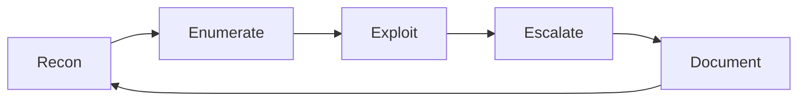

<h1 align="center">MD. MISBAHUL ISLAM SAAD</h1>

  CSE @ BRAC UNIVERSITY &nbsp;/&nbsp; SECURITY RESEARCH &nbsp;/&nbsp; PENTESTING

  
  
  
  

 

> **Understand the system. Break the system. Secure the system.**

I'm a computer science student who learns security by doing it: CTFs, hands-on labs, and taking things apart until I know why they work. This profile is a running log of where I am and where I'm headed.

 

## `01` &nbsp; Focus

| | |
|---|---|
| **Offensive** | Web application security, enumeration, privilege escalation |
| **Foundations** | Linux internals, networking, scripting |
| **Practice** | TryHackMe paths, picoCTF, bug bounty on HackerOne |
| **Coursework** | Databases, automata & computability, Java, digital logic |

 

## `02` &nbsp; Method

Every box I break gets a write-up. If I can't explain it, I haven't understood it.

 

## `03` &nbsp; Stack

  

**Next up:** Python, security automation, AI / ML and what it means for security.

 

## `04` &nbsp; Roadmap

- [ ] Finish the TryHackMe offensive paths
- [ ] Web pentesting and privilege escalation, end to end
- [ ] Learn Python and build my own security tooling
- [ ] First valid bug bounty report
- [ ] Explore AI security
- [ ] Become a professional penetration tester

 

## `05` &nbsp; Activity

  
  

 

  Open to CTF teams, security study groups, and collaboration.

